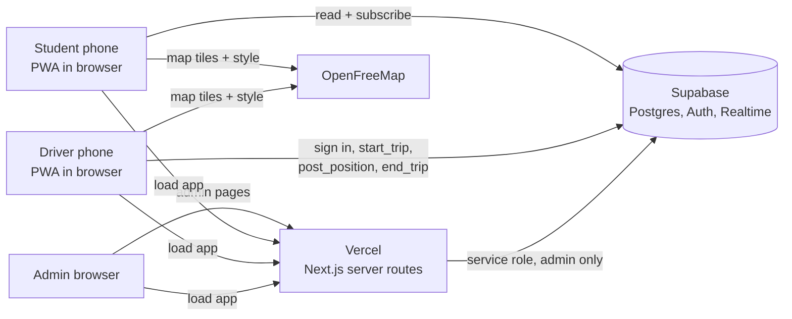
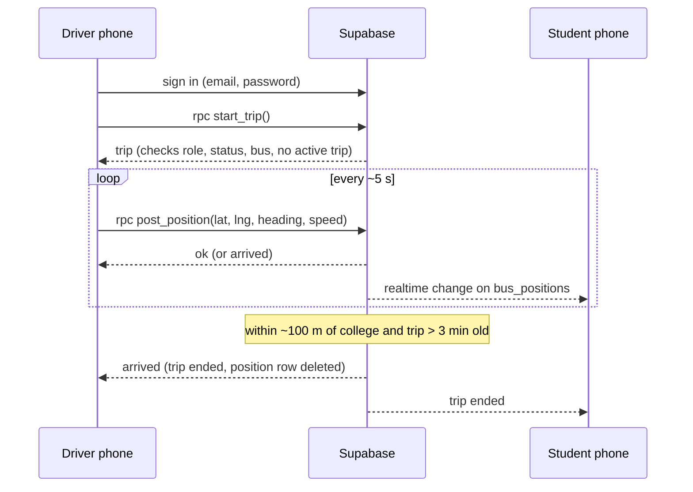

# Bus Tracker: Architecture

Version 0.1 · 4 Nov 2026. Related: PRD.md, PRODUCT.md, SYSTEM_DESIGN.md.

## 1. Overview

A serverless web app. Next.js on Vercel serves the pages and a few server routes. Supabase provides Postgres, Auth and Realtime. The browser talks to Supabase directly for reads and for the three trip functions. The database enforces every access rule, so the browser is never trusted.



## 2. Components

| Component | Responsibility | Runs on |
|---|---|---|
| Student app (`/`) | Map, ETA, stops, alert. Read only | Browser |
| Driver app (`/driver`) | Sign in, trip controls, GPS watch, wake lock | Browser on the driver's phone |
| Admin app (`/admin`) | Manage drivers, buses, active trips | Browser |
| Next.js server routes | Admin actions that need the service role: create driver, approve, remove, force end trip | Vercel |
| Supabase Auth | Email and password sessions for drivers and admin | Supabase |
| Postgres + RLS | Source of truth, access rules, trip functions | Supabase |
| Supabase Realtime | Pushes position changes to student browsers | Supabase |
| OpenFreeMap + MapLibre | Map style, tiles and rendering | Third party CDN and browser |

## 3. Key decisions

Each is short and revisitable.

### D1. Next.js on Vercel with Supabase
- **Why:** free tiers, one language, matches Uday's earlier projects, fast to ship.
- **Trade-off:** vendor coupling. Postgres and standard SQL keep the data portable.

### D2. Authorization in the database, not the app
- **Decision:** Row Level Security plus three `security definer` functions (`start_trip`, `post_position`, `end_trip`). No direct write policies on `trips` or `bus_positions`.
- **Why:** the browser holds the anon key, so anything the app "hides" can be called directly. Only the database can make the rule true.
- **Trade-off:** logic lives in SQL, which needs migration discipline and SQL tests.

### D3. Students are anonymous
- **Why:** removes sign up friction, which matters most for adoption. They can only read public bus data.
- **Trade-off:** no per-student features like saved stops across devices. Stop choice stays in `localStorage`. Add optional accounts only if v2 needs them.

### D4. Email and password for drivers in v1
- **Why:** phone OTP needs a paid SMS provider. Admin creates accounts, so open sign up is not needed.
- **Later:** phone OTP, or a magic link.

### D5. One latest-position row per bus
- **Why:** privacy and cost. Students need only the current location. History is not a v1 feature.
- **Trade-off:** no replay and no ETA learning from history. A `trip_points` table can be added later.

### D6. Realtime through Postgres Changes, with polling fallback
- **Why:** simplest to build: update the row, clients get the change.
- **Trade-off:** Postgres Changes does not scale to many viewers. The first scaling step is Realtime Broadcast, see SYSTEM_DESIGN.md.

### D7. Web app, not native, for v1
- **Why:** nothing to install, instant updates, Uday can test on his Android phone today.
- **Trade-off:** browsers stop GPS when the screen is off. Wake Lock keeps the screen on during a trip. A Capacitor wrapper is the escape hatch for background tracking.

### D8. MapLibre with OpenFreeMap
- **Why:** open source, no API key, no billing surprises.
- **Trade-off:** fewer map features than Google. Fine for v1.

## 4. Main flows

### Start and share a trip



### Student view
1. Load routes, stops, buses and the active trip with the anon key.
2. Subscribe to `bus_positions` and `trips`.
3. Compute ETA in the browser from the latest position and the route path.
4. If no update for 2 minutes, show offline. If the realtime socket drops, poll every 10 seconds until it reconnects.

## 5. Security model

| Threat | Control |
|---|---|
| Student calls start or stop directly | `start_trip`, `post_position`, `end_trip` check the caller is an approved driver. Execute is revoked from `anon` |
| Driver controls another bus | Functions use the bus from the driver's own profile row, never from the request |
| Fake positions from a stolen anon key | No write policy on `bus_positions`. Writes only through `post_position` |
| Spoofed location by a real driver | Accept as a known limit. Validate coordinate ranges and reject impossible jumps |
| Service role key leak | Only in Vercel server env vars. Never in client bundles. Rotate if exposed |
| Brute force sign in | Supabase Auth rate limits, friendly message on lockout |
| Role escalation | No policy lets a user update their own role or status. Only admin server actions change profiles |
| Stale trips | Server ends trips after 10 minutes without updates (`timeout`) |

## 6. Environments and deployment

| Environment | Frontend | Database |
|---|---|---|
| Local | `next dev` | Supabase local (CLI) or a dev project |
| Production | Vercel, `main` branch | Supabase project, migrations applied from `supabase/migrations/` |

- Environment variables: `NEXT_PUBLIC_SUPABASE_URL`, `NEXT_PUBLIC_SUPABASE_ANON_KEY`, `SUPABASE_SERVICE_ROLE_KEY` (server only).
- Migrations are the only way to change the schema. No edits in the dashboard.
- Test on a real phone over HTTPS. Geolocation and Wake Lock need a secure context.

## 7. Repo layout

```
app/                  routes: /, /driver, /admin, api/admin/*
components/           Map, BusMarker, EtaCard, StopChips, StopTimeline, AlertSwitch, TripButton
lib/                  supabase clients, eta.ts, geo.ts, route.ts, types
supabase/migrations/  schema, RLS, functions
supabase/seed.sql     placeholder route, bus, stops
design/reference.html UI prototype
docs/                 PRD, PRODUCT, ARCHITECTURE, SYSTEM_DESIGN, antigravity-prompt
AGENTS.md             short project context
```

## 8. Observability

- Vercel logs for server routes. Supabase logs for database and auth errors.
- A simple health view in the admin page: active trips, last position age per bus.
- Record counts only, as listed in PRODUCT.md section 9.

## 9. Cost

All free tiers for v1. The limits most likely to matter are Realtime connections and messages per second. See the watchlist in SYSTEM_DESIGN.md.

## 10. Evolution

| Need | Step |
|---|---|
| More viewers than the realtime limit | Move to Realtime Broadcast, add a server side fan out, or poll a cached endpoint |
| Background GPS | Capacitor wrapper with a foreground location service |
| Push alerts | Web Push with a service worker and stored subscriptions |
| Multiple routes | Already modeled. Add route picker and per route stops in the UI |
| ETA quality | Store trip points, learn per segment speeds by time of day |
