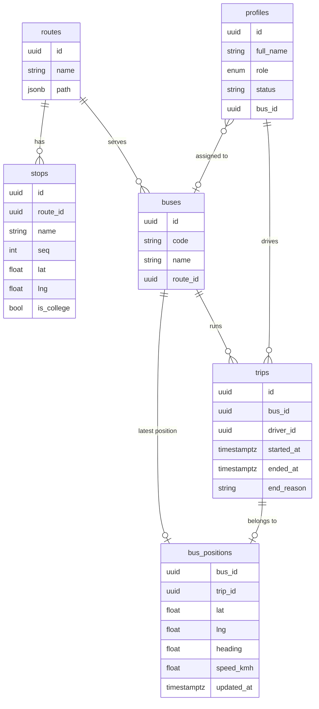
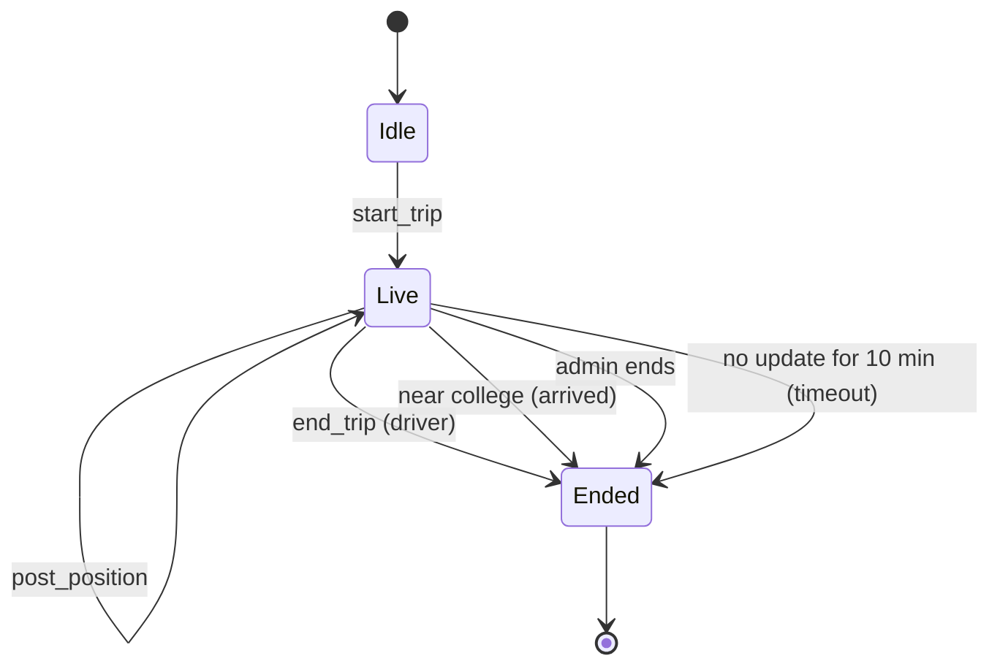

# Bus Tracker: System Design

Version 0.1 · 4 Nov 2026. Related: PRD.md, PRODUCT.md, ARCHITECTURE.md.

All numbers below are planning estimates for one bus, not measurements. Check the current Supabase and Vercel free tier limits before launch, because they change.

## 1. Requirements that drive the design

- One live bus, a few hundred riders, trips of roughly an hour. **(assumption)**
- Updates reach students in about 5 to 10 seconds.
- Strict write access: only the assigned approved driver changes a bus's state.
- Free tier hosting.

## 2. Capacity estimate

| Quantity | Value | Reasoning |
|---|---|---|
| Position writes per trip | about 720 | 1 trip hour, one write every 5 seconds |
| Write rate | 0.2 per second per bus | |
| Viewers online at once | 50 to 200 | Most riders open the app near stop time |
| Realtime deliveries | writes per second times viewers. 0.2 times 200 is about 40 per second | Each position change is sent to every subscribed viewer |
| Stored position rows | 1 per bus | Latest only |
| Trip rows | a few per day | Tiny |

Takeaway: storage is negligible. The pressure point is **realtime fan out**, 40 deliveries per second at 200 viewers. That can sit close to free tier realtime limits. Mitigations, in order:
1. Write every 5 seconds but let clients render smoothly between updates (already planned).
2. Reduce write rate to 10 seconds when the bus is far from every stop.
3. Switch to Realtime Broadcast, or serve a cached `GET /api/bus` that clients poll every 5 to 10 seconds, so fan out stays on the CDN.

## 3. Data model

Full SQL, RLS and functions are in `docs/antigravity-prompt.md` section 5.

**Route path.** `routes.path` is a GeoJSON LineString of the real road path, not straight lines between stops. ETA and the map line depend on it. Ways to get it, in order of effort:
1. Record it: the first real trip stores the driver's points, and a script simplifies them into the path.
2. Generate it with a routing service (OpenRouteService or OSRM) from the stop coordinates and save the result once.
3. Trace it by hand on a map.

## 4. Interfaces

Reads use the Supabase client with the anon key and RLS. Writes use three RPC functions.

| Function | Caller | Input | Output | Rejects when |
|---|---|---|---|---|
| `start_trip()` | Approved driver | none | `{ trip_id, bus_id, started_at }` | Not a driver, not approved, no bus, bus already has an active trip |
| `post_position(lat, lng, heading, speed_kmh)` | Driver with an active trip | numbers | `{ status: 'ok' }` or `{ status: 'arrived' }` | No active trip, bad coordinates, update less than 2 seconds after the last one |
| `end_trip()` | Driver with an active trip | none | `{ ended_at, end_reason }` | No active trip |

Admin actions run in Next.js server routes using the service role after checking the admin session:

| Route | Purpose |
|---|---|
| `POST /api/admin/drivers` | Create driver account and profile (pending) |
| `PATCH /api/admin/drivers/:id` | Approve, remove, assign bus |
| `POST /api/admin/trips/:id/end` | Force end a trip with reason `admin` |

Optional later: `GET /api/bus` returning the latest position and trip state with a short cache, for polling and for scaling.

## 5. Trip state machine

A trip is immutable after it ends. A new trip is a new row. The active trip is the row with `ended_at is null`, and a partial unique index allows at most one per bus.

## 6. ETA algorithm (client, pure function)

Inputs: latest position, recent positions or speeds, `routes.path`, ordered stops, config.

1. **Snap** the position to the path. Find the nearest point on the polyline and its distance along the path `s_bus`. Ignore the fix if it is more than about 100 m from the path.
2. **Place stops** on the path once: each stop gets `s_stop`, its distance along the path.
3. **Remaining distance** to stop i is `s_stop[i] - s_bus`. If it is negative, the bus has passed it.
4. **Speed**: exponential moving average of reported speed, `v = 0.3 * new + 0.7 * v`. Use `max(v, v_floor)` with `v_floor` about 15 km/h so a red light does not produce a huge ETA. Before the first speeds arrive use a default of about 20 km/h.
5. **Dwell**: add about 30 seconds for each stop between the bus and stop i.
6. **ETA seconds** = remaining distance / speed + dwell total.
7. **Delayed** label when the ETA is 5 or more minutes later than the first estimate for that stop on this trip.

Keep this in `lib/eta.ts` with unit tests: bus before stop, at stop, after stop, far from the path, zero speed, no speed data.

Later improvement: per segment average speeds learned from stored trip points by time of day.

## 7. Auto-end near the college

Inside `post_position`, after storing the position:

- Compute the haversine distance to the stop with `is_college = true`.
- If it is under about 100 m and `now - started_at > 3 minutes`, end the trip with reason `arrived`, delete the position row, return `{ status: 'arrived' }`.
- The 3 minute rule stops a driver who starts the trip near the college from ending it immediately.
- The distance and the minimum age are constants in one place so they can be tuned after real trips.

## 8. Staleness and cleanup

- Client: if `now - updated_at > 2 minutes`, show offline. The server is not involved.
- Server: a scheduled job (pg_cron if available, otherwise a protected Vercel cron route) ends trips whose position is older than 10 minutes with reason `timeout` and deletes their position rows.
- Trips older than 90 days can be deleted. There is no position history in v1.

## 9. Failure modes

| Failure | What users see | Handling |
|---|---|---|
| Driver phone loses data | Offline after 2 minutes | Queue the latest position and resend when online |
| Driver phone screen off | Updates stop | Wake Lock, on screen note. Escape hatch is a Capacitor app |
| Realtime socket drops | Marker freezes | Client reconnects, polls every 10 seconds meanwhile |
| Supabase outage | Student sees last known state with "No connection" | Static shell and cached stops still load through the service worker |
| Bad GPS fix | Jumping marker | Drop fixes with accuracy worse than 50 m, reject jumps faster than about 120 km/h |
| Two start taps | One trip | Unique active trip index makes the second call fail safely |
| Clock skew on phones | Wrong "updated N sec ago" | Use the server `updated_at`, not the phone clock |
| Driver account removed mid trip | Driver sees Removed | `post_position` re-checks status on every call |

## 10. Abuse and rate limits

- `post_position` ignores calls within 2 seconds of the last one and rejects values outside valid latitude and longitude ranges.
- Students have read access only. Add a CDN cache or the polling endpoint if scraping becomes a problem.
- Supabase Auth limits sign in attempts. Show a friendly message when it triggers.
- Keep the admin routes behind a server side role check on every request.

## 11. Testing plan

| Layer | Tests |
|---|---|
| SQL access | As anon: cannot insert into `trips` or `bus_positions`. As a student account: `start_trip` fails. As a pending driver: `start_trip` fails. As driver A: cannot post for driver B's bus. Second active trip on one bus fails |
| Functions | Arrival ends the trip only after 3 minutes. Updates under 2 seconds apart are ignored. Out of range coordinates are rejected |
| ETA | Unit tests listed in section 6 |
| Driver flow | Permission denied, offline, screen lock, sign out blocked during a trip |
| Student flow | Each state in PRODUCT.md section 4 |
| Field test | Real trip on Uday's route with two phones, compare predicted and actual arrival at each stop |

## 12. Free tier watchlist

Check these on the Supabase and Vercel pricing pages before launch:

- Realtime concurrent connections and messages per second.
- Database size and egress. Position rows are tiny, but realtime and polling add egress.
- Auth emails per hour, relevant if you use magic links or password reset.
- Project pausing after inactivity on the free plan, which would take the app down. Keep it active or use a scheduled ping.
- Vercel function invocations and cron frequency limits.

## 13. Scaling path

1. Throttle the write rate by distance to the next stop.
2. Add `GET /api/bus` with a 3 to 5 second cache, and let students poll.
3. Move to Realtime Broadcast for position messages and keep Postgres for state.
4. Add `trip_points` for history and ETA learning.
5. Add per route channels when several buses are live.
